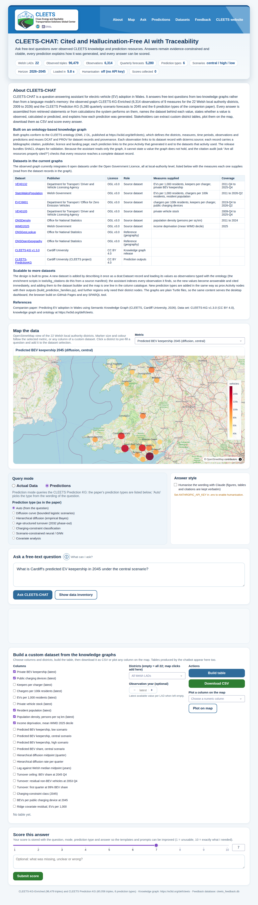

# CLEETS-CHAT: Cited and Hallucination-Free AI with Traceability

Question answering over the CLEETS knowledge graphs of electric-vehicle adoption in Wales. Users ask free-text questions about observed data (private battery-electric cars and private cars, battery-electric vehicle keepership, public charging devices, population, density, income deprivation for the 22 Welsh local authority districts) or about the predictions of the companion paper *Predicting electric vehicle adoption in Wales from open data integrated in semantic knowledge graphs*. Every answer is composed from retrieved RDF statements or deterministic calculations over the graphs, cites its source datasets, states whether a value is observed, calculated or predicted, and explains how each prediction was generated. Stakeholders can extract custom per-district tables, plot them on an OpenStreetMap view and download them, and score every answer from 1 to 10.

**Live demo (GitHub Pages):** `https://naeima.github.io/cleets-chat/` (after the steps in [Publishing](#publishing-on-github-and-github-pages)). The page runs the same Python question-answering code in the browser, so no server is needed.



<!-- about:start -->
## About CLEETS-CHAT

CLEETS-CHAT is a question-answering assistant for electric-vehicle (EV) adoption in Wales. It answers free-text questions from two knowledge graphs rather than from a language model's memory: the observed graph CLEETS-KG-Enriched (10,516 observations of 13 measures for the 22 Welsh local authority districts, 2009 to 2026, and 5,170 observations of two cohort tables of licensed cars) and the CLEETS Prediction KG (5,280 quarterly scenario predictions of private battery-electric cars to 2045 and 6 prediction types). Every answer is assembled from retrieved statements or from calculations the system performs on them, names the dataset behind each value, states whether a value is observed, calculated or predicted, and explains how each prediction was generated. Stakeholders can extract custom district tables, plot them on the map, download them as CSV and score every answer.

### Built on an ontology-based knowledge graph

Both graphs conform to the CLEETS ontology (OWL 2 DL, published at https://w3id.org/def/cleets), which defines the districts, measures, time periods, observations and predictions and reuses DCAT and PROV for dataset records and provenance. Each observation links to its dataset record with dcterms:source; each record carries a bibliographic citation, publisher, licence and landing page; each prediction links to the prov:Activity that generated it and to the datasets that activity used. The release bundles SHACL shapes for validation. Because the assistant reads only the graph, it cannot state a value the graph does not hold, and the citation audit (ask "Are all resources properly cited?") checks that every resource reaches a complete dataset record.

### Datasets in the current graphs

The observed graph currently integrates 10 source tables published under the Open Government Licence, listed below with the measures each one supplies, the number of observations and the period covered (read from the dataset records in the graph). Most are held by local authority district and quarter or year. The two cohort tables (VEH9901 and VEH1111) are held as RDF Data Cube observations by year of first registration and include national rows; they supply the starting stock, the scrappage rates and the second-hand entry of the fleet turnover model. The paper counts the two WIMD 2025 tables as one dataset.

| Dataset | Publisher | Licence | Role | Measures supplied | Coverage |
|---|---|---|---|---|---|
| [VEH0105](https://www.gov.uk/government/statistical-data-sets/vehicle-licensing-statistics-data-tables) | Department for Transport / Driver and Vehicle Licensing Agency | OGL v3.0 | Source dataset | private cars (all fuels), private petrol hybrid vehicles (all body types), private vehicle stock (all body types) | 2009-Q4 to 2025-Q4 |
| [VEH1111](https://www.gov.uk/government/statistical-data-sets/vehicle-licensing-statistics-data-tables) | Department for Transport / Driver and Vehicle Licensing Agency | OGL v3.0 | Source dataset | licensed cars at each year end by year of first use (Great Britain, Wales) | 2009-Q4 to 2025-Q4 |
| [VEH0132](https://www.gov.uk/government/statistical-data-sets/vehicle-licensing-statistics-data-tables) | Department for Transport / Driver and Vehicle Licensing Agency | OGL v3.0 | Source dataset | EVs per 1,000 residents, keepers per charger, private BEV keepership (all body types) | 2011-Q4 to 2025-Q4 |
| [StatsWalesPopulation](https://stats.gov.wales/en-GB/topic/71/people-identity-equality) | Welsh Government | OGL v3.0 | Source dataset | EVs per 1,000 residents, chargers per 100k residents, resident population | 2011 to 2026-Q2 |
| [EVCI9001](https://www.gov.uk/government/collections/electric-vehicle-charging-infrastructure-statistics) | Department for Transport / Office for Zero Emission Vehicles | OGL v3.0 | Source dataset | chargers per 100k residents, keepers per charger, public charging devices | 2019-Q4 to 2026-Q2 |
| [VEH9901](https://www.gov.uk/government/statistical-data-sets/vehicle-licensing-statistics-data-tables) | Department for Transport / Driver and Vehicle Licensing Agency | OGL v3.0 | Source dataset | licensed cars by year of first registration, fuel group and keepership (Welsh local authority districts, United Kingdom) | 2026-Q2 |
| [VEH0142](https://www.gov.uk/government/statistical-data-sets/vehicle-licensing-statistics-data-tables) | Department for Transport / Driver and Vehicle Licensing Agency | OGL v3.0 | Source dataset | private battery-electric cars | 2009-Q4 to 2026-Q2 |
| [ONSDensity](https://www.ons.gov.uk/peoplepopulationandcommunity/populationandmigration/populationestimates) | Office for National Statistics | OGL v3.0 | Source dataset | population density (persons per sq km) | 2011 to 2024 |
| [WIMD2025](https://www.gov.wales/welsh-index-multiple-deprivation) | Welsh Government | OGL v3.0 | Source dataset | income deprivation (mean WIMD decile of the district's LSOAs) | 2025 |
| [WIMD2025LocalAuthority](https://stats.gov.wales/en-GB/c28ab0ec-5893-46c2-a372-98d4058ba415) | Welsh Government | OGL v3.0 | Source dataset | people in income deprivation (%, WIMD 2025 local authority indicator) | 2025 |
| [ONSGeoLookup](https://geoportal.statistics.gov.uk/) | Office for National Statistics | OGL v3.0 | Reference (geography) |  |  |
| [ONSOpenGeography](https://geoportal.statistics.gov.uk/) | Office for National Statistics | OGL v3.0 | Reference (geography) |  |  |
| [CLEETS-KG v1.3.0](https://w3id.org/def/cleets) | Cardiff University | CC BY 4.0 | Knowledge graph release |  |  |
| [CLEETS-PredictionKG](https://w3id.org/def/cleets) | Cardiff University (CLEETS project) | CC BY 4.0 | Prediction outputs |  |  |

### Scalable to more datasets

The design is built to grow. A new dataset is added by describing it once as a dcat:Dataset record and loading its values as observations typed with the ontology (the enrichment scripts in tools/kg_citations do this from a source manifest); the assistant indexes every observation it finds, so the new values become answerable and cited immediately, and adding them to the dataset builder and the map is one line in the column catalogue. New prediction types are added in the same way as prov:Activity nodes with their outputs (build_prediction_families.py), and further regions only need their district nodes. The graphs are plain Turtle files, so the same content serves the desktop dashboard, the browser build on GitHub Pages and any SPARQL tool.

### References

Companion paper: Predicting electric vehicle adoption in Wales from open data integrated in semantic knowledge graphs (CLEETS, Cardiff University, 2026). Data set: CLEETS-KG v1.3.0 (CC BY 4.0), knowledge graph and ontology at https://w3id.org/def/cleets; the tables added since that release are loaded from supplement graphs in the data folder of the repository.
<!-- about:end -->

## Contents

- [About CLEETS-CHAT](#about-cleets-chat)
- [What it does](#what-it-does)
- [Prediction types](#prediction-types)
- [Quick start (local)](#quick-start-local)
- [Using the chatbot](#using-the-chatbot)
- [How it was built (reproducibility)](#how-it-was-built-reproducibility)
- [Repository layout](#repository-layout)
- [Tests](#tests)
- [Deployment options](#deployment-options)
- [Publishing on GitHub and GitHub Pages](#publishing-on-github-and-github-pages)
- [Data, licences and citation](#data-licences-and-citation)
- [Limitations](#limitations)

## What it does

| Component | Behaviour |
|---|---|
| Actual Data mode | Retrieves observed statements for a district, a measure, a ranking or a comparison from CLEETS-KG-Enriched and prints them as evidence with the dataset behind each value. |
| Prediction mode | Answers from the Prediction KG: district predictions by quarter, year and scenario, three-scenario comparisons, rankings, milestones, Wales summaries, provenance; routed to the prediction type the question concerns (or forced with the selector). |
| ⓘ How was this predicted? | A panel under every prediction answer describing the method, its assumptions, the source datasets and the paper section and notebook stage that produced it (`methods.py`, values filled from the graph). |
| Custom datasets | "Give me a table of battery-electric cars, keepership, charging count, deprivation, population and population density for the 22 LADs" (or the builder panel) yields a per-district table with its sources, a CSV download, and a map coloured by any column. |
| Map | OpenStreetMap view of the 22 districts coloured by observed, predicted or custom-dataset metrics; clicking a district pre-fills a question and adds it to the dataset selection. |
| Scope check | Before any retrieval, `scope.py` tests the question against what the loaded graphs hold (district names, measures, prediction types, dataset records and ontology terms, all read from the graphs). A question outside them, "What is the weather in Cardiff?", "How much does a charger cost?", "How many EVs are in Birmingham?", "What is Cardiff's keepership in 2060?", is answered with *Not modelled in the knowledge graph*, a one-line reason naming the missing dataset, geography or period, and what the graphs do cover. |
| Humanisation (optional) | With `ANTHROPIC_API_KEY` set, the prose of templated answers is reworded by Claude under a constraint prompt; figures, tables and citations are never passed through the model. Off by default. |
| Feedback | Every answer can be scored 1–10 with notes; stored in `cleets_feedback.db` and analysed by `analyze_feedback.py` (the static site keeps scores in the browser and exports them as CSV). |

## Prediction types

The Prediction KG carries one `prov:Activity` per prediction type; every per-district resource links to its activity with `prov:wasGeneratedBy`, so the chatbot can say which model produced a number.

| Type | Paper section | Notebook section | Loaded from |
|---|---|---|---|
| Bounded logistic diffusion capped by the fleet turnover path (central / low / high, quarterly to 2045): private battery-electric cars, their share of private cars and the petrol and diesel cars remaining | 4.2, 4.6, 5.4 to 5.8 | 6, 7, 13 | `data/cleets_prediction_kg.ttl` |
| Hierarchical diffusion, two-stage empirical Bayes (midpoint, rate, shrinkage; covariate effects) | 4.3, 5.4 | 8 | `data/cleets_prediction_families.ttl` |
| Fleet turnover path from observed scrappage and second-hand entry (district inputs and results, Wales path by scrappage period, Weibull ceiling as a benchmark) | 4.6, 5.6 to 5.8 | 6, 11 | `data/cleets_prediction_families.ttl` |
| Model comparison: turnover-constrained neural and graph neural predictions, bounded logistic and drift, one quarter and 1 to 16 quarters ahead | 4.4, 4.5, 5.5 | 9, 10 | `data/cleets_prediction_families.ttl` |
| Charging-provision constraint classification for 2045 (September 2026 analysis, not in the paper) | none | earlier notebook, Stage 8 | `data/cleets_prediction_families.ttl` |
| Cross-sectional covariate comparison (September 2026 analysis, not in the paper) | none | earlier notebook, Stages 4a-bis, 5 | `data/cleets_prediction_families.ttl` |

Details and the question keywords that select each type: [docs/guides/PREDICTION_TYPES.md](docs/guides/PREDICTION_TYPES.md).

## Quick start (local)

Requires Python 3.10 or later.

```bash
git clone https://github.com/Naeima/cleets-chat.git
cd cleets-chat
python -m venv venv
source venv/bin/activate          # Windows: venv\Scripts\activate.bat
pip install -r requirements.txt
python app.py                     # open http://localhost:8050
```

Optional: copy `.env.example` to `.env` and set `ANTHROPIC_API_KEY` to enable humanisation, `PORT` to change the port. The CLEETS logo ships as `assets/cleets_logo.png` (and `docs/assets/cleets_logo.png` for the Pages site) and appears in the header, a banner in the style of the CLEETS Global Center website (site blue, logo left, navigation right, light sweep); without the file the banner draws the CLEETS wordmark. The logo sits in a white card so it shows on the blue (`LOGO_CARD=0` removes the card); `SHOW_WORDMARK=1` shows the wordmark next to the logo. `QUICKSTART.sh` / `QUICKSTART.bat` do the environment steps for you; [docs/guides/COMMAND_PROMPT_SETUP.md](docs/guides/COMMAND_PROMPT_SETUP.md) has the copy-paste commands for Windows, macOS and Linux.

## Using the chatbot

The ⓘ button next to the question box lists example questions per family (observed data, custom datasets, reasoning, provenance and knowledge graph; quarterly predictions, hierarchical diffusion, turnover path, model accuracy, charging constraint, covariate analysis). Examples:

- `How many private battery-electric cars are predicted for Cardiff in 2045 under the central scenario?`
- `Compare Cardiff across all three scenarios in 2045.`
- `What is the turnover path for Ceredigion?` · `How old are the private cars in Blaenau Gwent?`
- `Which LADs diffuse most slowly?`
- `Where may charging provision be the principal constraint?`
- `How does income deprivation relate to EV adoption?`
- `Give me a table of battery-electric cars, keepership, charging count, deprivation, population and population density for the 22 LADs.`
- `Which model is most accurate?` (ranks the five models of the paper's comparison by backtest error, one quarter and up to 16 quarters ahead)
- `What do you know about Cardiff?` · `Which LAD has the most public EV chargers?` · `Which dataset supports this answer?` · `Are all resources properly cited?`

Answers end with a **Sources** line built from the graph (dataset landing pages and the CLEETS knowledge graph) and, for predictions, the prediction type and the ⓘ panel. A question whose subject is not in the graphs is not answered with unrelated evidence: the scope check (`scope.py`) replies *Not modelled in the knowledge graph* and says why in a line, distinguishing an unmodelled topic (prices, emissions, charger speeds, fuel types, weather, finer geographies, ...; the reason names the dataset that would have been needed), a place outside the 22 Welsh districts (English districts are reported with what the graph holds for them, population density only), a year outside the observed or predicted periods, and a question that names nothing held in the graphs. Greetings and questions about the assistant itself get a short description of what it can answer. `Are all resources properly cited?` runs `CLEETSKG.citation_audit()`: it checks that every observation, prediction, family resource and activity in the loaded graphs reaches a complete `dcat:Dataset` record (identifier, title, publisher, licence, bibliographic citation, landing page) and prints the citations.

## How it was built (reproducibility)

The system is a chain of artefacts; each step below names the input, the command and the output, so any step can be re-run when a source table is updated.

### 1. Source data

Ten source tables and two reference records, all under the Open Government Licence v3 (citations rendered from the dataset records in the graph):

| Record | Dataset | Publisher |
|---|---|---|
| VEH0132 | Licensed ultra low emission vehicles by fuel type, keepership and local authority (private battery-electric extract) | DfT / DVLA |
| VEH0105 | Licensed vehicles by body type, fuel type, keepership and local authority: private vehicles of all body types and, in `data/cleets_private_cars.ttl`, private cars of all fuels and private petrol hybrid vehicles | DfT / DVLA |
| VEH0142 | Licensed plug-in vehicles by body type, fuel type, keepership and local authority: private battery-electric cars, 2009 Q4 to 2026 Q2 (the numerator of the adoption share). Held in `data/cleets_private_cars.ttl` | DfT / DVLA |
| VEH9901 | Licensed cars by local authority, keepership, fuel and year of first registration at 2026 Q2: the starting stock of the turnover model. Held as RDF Data Cube observations in `data/cleets_car_cohorts.ttl` | DfT / DVLA |
| VEH1111 | Licensed cars at each year end by year of first use, Great Britain and Wales: scrappage and second-hand entry by age. Held as RDF Data Cube observations in `data/cleets_car_cohorts.ttl` | DfT / DVLA |
| EVCI9001 | Public EV charging devices, United Kingdom (historic table, quarterly) | DfT / OZEV |
| StatsWalesPopulation | Population estimates by local authority and year (mid-year estimates) | Welsh Government |
| ONSDensity | Population density (persons per square kilometre), England and Wales | ONS |
| WIMD2025 | Welsh Index of Multiple Deprivation, income domain deciles by LSOA | Welsh Government |
| WIMD2025LocalAuthority | WIMD 2025 indicator data for local authorities and Wales: people in income deprivation (percentage), as published. Held in `data/cleets_income_deprivation_la.ttl` (written by `tools/build_income_deprivation_la.py`) and loaded with the observation graph; it is what "income deprivation" returns. The mean LSOA decile of the released graph is returned for "decile". | Welsh Government |
| ONSGeoLookup, ONSOpenGeography | LSOA to local authority lookup; statistical geography codes and names | ONS |

### 2. Ontology and observed knowledge graph

- The CLEETS ontology (OWL 2 DL, published at https://w3id.org/def/cleets) defines districts, observations, measures, time entities and provenance terms; the release graph declares `dcterms:conformsTo` it and bundles the SHACL shapes used for validation.
- `notebooks/Final_Modelling_CLEETS_all_body_types_private_keepership.ipynb`, Stages 1–3 and 12, builds the ontology, populates CLEETS-KG from the source tables, adds the commonsense (CSKG) alignment layer and writes the release graph `cleets_kg_v130.ttl` (87,824 triples).
- `tools/kg_citations/enrich_citations.py` adds the citation layer (`dcterms:source` from every observation to its `dcat:Dataset` record, rendered `dcterms:bibliographicCitation`, licence, publisher and landing page per dataset, `prov:wasGeneratedBy` activities for derived indicators) from a source manifest `cleets_sources.json`, and `tools/kg_citations/validate.py` re-checks the result with SHACL and a SPARQL coverage audit. Output: `data/cleets_cskg_enriched.ttl` (CLEETS-KG-Enriched v1.3.0, 96,479 triples: 22 Welsh LADs with 6,314 observations over nine measures, 296 English LADs with population density, 8 dataset records).
- `tools/build_observed_supplements.py` copies the tables added since the v1.3.0 release from the graph that the companion notebook builds (`cleets_kg_built.ttl`): `data/cleets_private_cars.ttl` (the VEH0142 record, 1,474 observations of private battery-electric cars, 1,430 of private cars and 1,276 of private petrol hybrid vehicles) and `data/cleets_car_cohorts.ttl` (the VEH9901 and VEH1111 records and 5,170 RDF Data Cube observations by year of first registration, fuel group and keepership). `kg_service.OBSERVED_SUPPLEMENTS` loads both with the observation graph, so the About table, the citation audit and the answers include them.
- `tools/extract_panel.py` extracts the quarterly district panel used by every prediction type from the enriched graph by SPARQL (one query per measure, joined on district code, year and quarter). Output: `data/cleets_lad_quarter_panel.csv`, one row per Welsh LAD and quarter, 2009-Q4 to 2026-Q2 (1,474 rows): private battery-electric keepership (VEH0132), public charging devices (EVCI9001), private vehicle stock, private petrol hybrid vehicles and private cars (VEH0105), private battery-electric cars (VEH0142), the adoption share on each scope, EVs per 1,000 residents, chargers per 100k residents, keepers per charger, population, density and WIMD 2025 income decile. Load it directly with `pd.read_csv("https://raw.githubusercontent.com/Naeima/cleets-chat/main/data/cleets_lad_quarter_panel.csv")`, or regenerate it with `python tools/extract_panel.py`.

### 3. Models and the Prediction KG

The predictions are those of the companion notebook of the paper, `EVAdoptionWalesPredictionsModels` (24 November 2026). Its exports are kept in `data/notebook_exports/` and two tools write them to the Prediction KG; nothing is re-estimated in this repository. The notebooks in `notebooks/` are the earlier (September 2026) analyses, from which the charging-constraint and covariate types still come.

- `python tools/build_prediction_kg.py` writes `data/cleets_prediction_kg.ttl` from `diffusion_scenarios_to_2045.csv`: 5,280 district-quarter predictions (22 districts, 2026 Q1 to 2045 Q4, three scenarios) plus Wales totals and the 10%, 25%, 50% and 75% milestones reached within the horizon. The adoption share is private battery-electric cars (VEH0142) over private cars (VEH0105). Each prediction holds the predicted battery-electric cars and share, the petrol and diesel cars remaining, hybrids included (`cleets:predictedNonBEVStock`), the fitted curve (`cleets:fittedCurveShare`), the district's turnover path (`cleets:turnoverPathShare`), whether the reported value is the path (`cleets:onTurnoverPath`) and the private cars at 2026 Q2 (`cleets:privateCarStock`). Each district follows the lower of its fitted logistic curve and its turnover path, a stock-flow model built from observed scrappage (VEH1111) and the ages at which cars enter private keepership (VEH9901). Scenarios: central (sales rule of 80% battery-electric new cars in 2030 and 100% in 2035, scrappage rates of 2021 to 2025), low (2030 level of 50%) and high (scrappage rates of 2014 to 2019). In the central scenario Wales has 1,274,581 private battery-electric cars at 2045 Q4, 81.14% of private cars, with 296,246 petrol and diesel cars remaining.
- `python tools/update_prediction_families.py` refreshes three types in `data/cleets_prediction_families.ttl`: hierarchical diffusion (`hierarchical_midpoints.csv`, `hierarchical_covariate_effects.csv`), the fleet turnover path (district inputs and results, the Wales path under the scrappage rates of three periods, and the Weibull ceiling as a benchmark) and the model comparison (`walk_forward_backtests.csv`, `multi_horizon_backtest.csv`). It writes one `prov:Activity` per type (label, method comment, paper section, notebook section, bibliographic citation, `prov:used` datasets) and typed resources (`cleets:DiffusionParameterEstimate`, `cleets:ElectrificationArrival`, `cleets:AdoptionMilestonePrediction`, `cleets:TurnoverCeiling`, `cleets:ModelMetric`), each with `prov:wasGeneratedBy` and `dcterms:source` links.
- `build_prediction_families.py` is the builder of the September 2026 analyses (charging-provision constraint and cross-sectional covariates), kept for reference; those two types are labelled as earlier analyses in the app.
- Accuracy, from the paper's model comparison (one quarter ahead, MAE in cars, lowest first): persistence + drift 17.62, turnover-constrained neural network 18.89, turnover-constrained graph neural network 28.05, bounded logistic 28.51, unconstrained neural network 260.41. Rolled forward from the same origins, the logistic fitted to the full history has the lowest MAE from four quarters ahead (169.7 against 190.8 for drift at eight quarters), which is why it is the curve that the turnover path caps. Charger counts are not predicted.
- Two supplementary notebooks are included and run end to end: `notebooks/cleets_quarterly_forecast_corrected_accuracy.ipynb` (quarterly walk-forward comparison of naive, log-trend and vehicle-stock-bounded logistic models with a hybrid forecast to 2045) and `notebooks/cleets_monthly_quarterly_ev_charger_forecasting_pipeline.ipynb` (monthly and quarterly charger forecasting, bounded logistic, MLP and GCN backtests, publication maps).

### 4. Question answering

- `kg_service.py` loads the graphs with rdflib and builds in-memory indexes once (districts and aliases, periods, observations per district, predictions per district and scenario, prediction families, dataset records). Every value the chatbot prints is read from these indexes; nothing is estimated at query time.
- `qa_with_humanization.py` (imported as `qa`) turns a question into an answer with rules, not a language model: district names by alias matching, years and scenarios by pattern, prediction type by keyword routing, measures by vocabulary, and fixed Markdown templates per question family; `table_answer()` builds the custom datasets. `methods.py` holds the ⓘ texts, written from the notebook stages and filled with the scenario constraints, coefficients, ceilings and metrics stored in the graph; `about.py` holds the About text and reads the dataset catalogue (`CLEETSKG.dataset_catalogue()`) from the graph, so a newly added dataset is listed automatically.
- `app.py` is the Dash interface; `evaluate_answers.py` runs a benchmark of question templates against SPARQL gold answers; `analyze_feedback.py` summarises the stakeholder scores.

### 5. Static site for GitHub Pages

GitHub Pages serves static files only, so `build_site.py` exports the indexes to `docs/data/kg_snapshot.json` and copies the Python modules to `docs/py/`; `docs/index.html` loads them in the browser through Pyodide, and `tests/test_snapshot.py` checks that the snapshot gives the same answers as the rdflib-backed service.

```bash
python build_site.py     # rebuild docs/ after changing the graphs or the Python modules
```

## Repository layout

```
app.py                         Dash dashboard (map, chatbot, ⓘ panels, dataset builder, scoring)
kg_service.py                  rdflib access layer, indexes, prediction families, dataset extraction, JSON snapshot
qa.py / qa_with_humanization.py  deterministic question answering; optional Claude rewording
scope.py                       scope check: "not modelled in the knowledge graph" answers, with the reason, for questions outside the graphs
methods.py                     "how was this predicted" texts per prediction type
about.py                       "About CLEETS-CHAT" text; datasets and figures filled from the graph (also refreshes the README block)
build_prediction_families.py   builder of the September 2026 analyses (charging constraint, covariates)
build_site.py                  -> docs/ (GitHub Pages build)
analyze_feedback.py, evaluate_answers.py
data/                          cleets_cskg_enriched.ttl and its supplements (cleets_income_deprivation_la.ttl, cleets_private_cars.ttl,
                               cleets_car_cohorts.ttl), cleets_prediction_kg.ttl, cleets_prediction_families.ttl, cleets_lad_quarter_panel.csv,
                               notebook_exports/ (CSV exports of the companion notebook behind the Prediction KG)
docs/                          GitHub Pages site (index.html, app.js, style.css, data/, py/) and guides/
notebooks/                     notebooks of the September 2026 analyses and two supplementary pipelines
tools/kg_citations/            citation-layer enrichment and validation for the knowledge graph
tools/extract_panel.py         SPARQL extraction of the quarterly LAD panel -> data/cleets_lad_quarter_panel.csv
tools/build_observed_supplements.py   tables added since the v1.3.0 release -> data/cleets_private_cars.ttl, data/cleets_car_cohorts.ttl
tools/build_income_deprivation_la.py  published WIMD 2025 local authority percentages -> data/cleets_income_deprivation_la.ttl
tools/build_prediction_kg.py   notebook export -> data/cleets_prediction_kg.ttl (quarterly predictions capped by the turnover path)
tools/update_prediction_families.py   notebook exports -> hierarchical, turnover and model-comparison types in data/cleets_prediction_families.ttl
tests/                         pytest smoke tests and snapshot round-trip
assets/                        cleets_logo.png (header logo)
```

## Tests

```bash
pip install -r requirements-dev.txt
pytest -q
```

The tests load the graphs, answer every example question in the help panel, build a dataset, check the ⓘ panels, check the model ranking and the turnover path against the paper's values and the citation audit (every resource reaches a complete dataset record), and verify that the GitHub Pages snapshot answers identically. `.github/workflows/ci.yml` runs them on every push.

## Deployment options

- **Local**: `python app.py` (see Quick start).
- **Docker**: `docker build -t cleets-chat . && docker run -p 8050:8050 cleets-chat` (add `-e ANTHROPIC_API_KEY=...` for humanisation).
- **Gunicorn / PaaS**: `Procfile` runs `gunicorn app:server`; works on Render, Railway, Heroku and similar.
- **GitHub Pages** (no server, all features except humanisation and the shared feedback database): see below.

## Publishing on GitHub and GitHub Pages

1. Create an empty repository on GitHub named `cleets-chat` (no README, licence or .gitignore; they are here).
2. From this folder:

   ```bash
   git init -b main
   git add .
   git commit -m "CLEETS-CHAT: cited question answering over the CLEETS knowledge graphs"
   git remote add origin https://github.com/Naeima/cleets-chat.git
   git push -u origin main
   ```

3. On GitHub: **Settings → Pages → Build and deployment → Source: Deploy from a branch → Branch: main, folder: /docs → Save.** The site is live at `https://naeima.github.io/cleets-chat/` after a minute or two.
4. Put the link in this README (top) and in the repository description. Add `assets/cleets_logo.png` and `docs/assets/cleets_logo.png` for the logo.

Whenever the graphs or the Python modules change: `python build_site.py`, run the tests, commit `docs/` with the code.

## Data, licences and citation

- Code: MIT License (see `LICENSE`).
- Knowledge graphs (`data/*.ttl`) and the extracted district panel (`data/cleets_lad_quarter_panel.csv`): CC BY 4.0, as declared in their dataset records. Cite the release graph as:

  > Hamed, N., Yao, F., Potoglou, D., Haggar, P., Sharma, A., Wadhwa, A. & Rana, O. (2026) CLEETS-KG v1.3.0: knowledge graph of electric-vehicle adoption and charging provision across Welsh local authority districts [Data set]. Zenodo. (DOI to be minted on deposit.)

- Source statistics: DfT/DVLA VEH0132 and VEH0105, DfT/OZEV EVCI9001, Welsh Government StatsWales population estimates and WIMD 2025, ONS population density and geography lookups, all under the Open Government Licence v3; full citations and landing pages are stored in the graph and printed by the chatbot.
- Software citation: see `CITATION.cff`.

CLEETS is funded under an NSF–UKRI Global Centre (NSF award 2330565, UKRI grant EP/Y026233/1).

## Limitations

- The question-answering path is rule- and template-based: it answers the families listed in the help panel and declines the rest; it does not generate text. Optional humanisation uses a language model for wording only.
- Predictions are model outputs under stated assumptions (the sales rule for new cars, the scrappage rates of 2021 to 2025 and a private car stock held at its 2026 Q2 level); the chatbot labels them as such. Values reflect the notebook run that produced the graphs; the notebook's paper parity check lists where a run differs from the manuscript.
- Retrieval in Actual Data mode is keyword-based over the indexed measures; unusual phrasings may need the wording of the help panel.
- The scope check is vocabulary-based: district names, measures, prediction types, datasets and ontology terms come from the graphs, the rest from small lexicons in `scope.py` (synonyms, stop words, a curated list of unmodelled topics). A term it does not recognise is reported as not modelled with a pointer to the help panel; adding a dataset to the graph makes its measure answerable, but a new synonym for it has to be added to the lexicon.
- The GitHub Pages build loads a 6 MB snapshot and a Python runtime on first visit; scores entered there stay in the visitor's browser.

## Contact

Naeima Hamed, Cardiff University: hamdnh@cardiff.ac.uk and nhamed@illinois.edu. Issues and pull requests are welcome.
